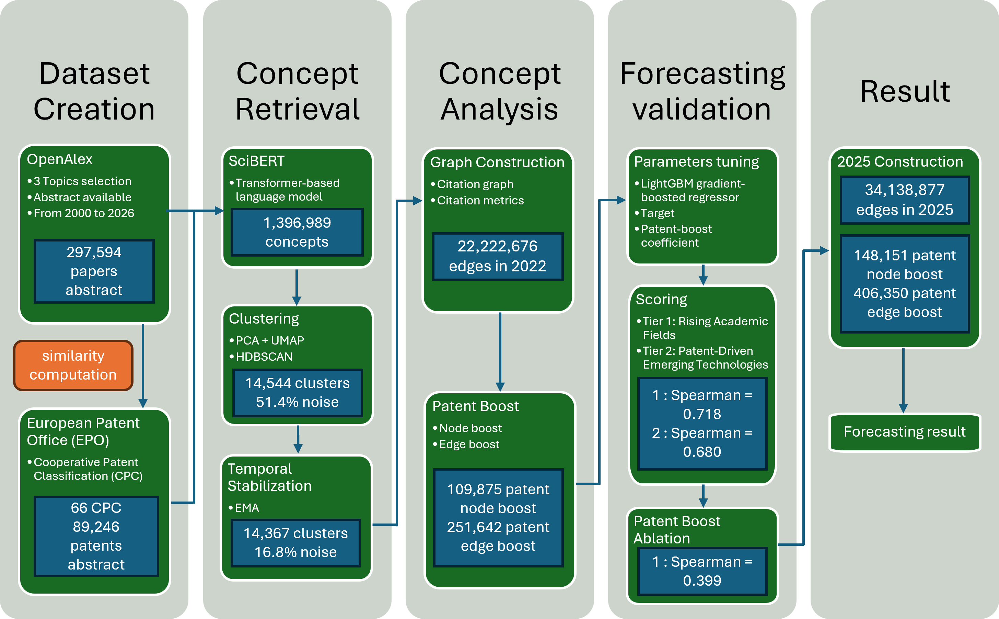

# Forecasting Emerging Technologies Using Scientific and Patent Data

This repository contains the code developed for my Master's thesis on forecasting emerging and disruptive technologies by combining scientific publication data, citation-network dynamics, and patent-derived signals.

The framework was evaluated on **quantum information science** and aims to identify research areas likely to experience strong future growth.

You can found the Thesis report [here](https://github.com/KimiNoPanda/Forecast_Papers_and_Patent/blob/main/Thesis/Master_Thesis_Dominique_Huang.pdf) 

## Overview

The methodology combines:

- Scientific publications and citation data from OpenAlex
- Patent data and patent–concept associations
- SciBERT-based concept extraction
- Semantic clustering and temporal cluster stabilization
- Temporal citation-network construction
- Patent-informed node and edge signals
- Network and bibliometric feature engineering
- LightGBM forecasting
- A two-tier ranking framework for emerging technologies

The forecasting model predicts three-year-ahead growth in the citation-network influence of research clusters.

## Pipeline

The main pipeline can be summarized as:

1. **Data collection**
   - Retrieve scientific publications and citation relationships
   - Retrieve and process patent information

2. **Concept extraction**
   - Extract scientific concepts from paper abstracts using SciBERT
   - Clean and normalize extracted concepts

3. **Concept clustering**
   - Generate semantic embeddings
   - Cluster related concepts
   - Stabilize cluster identities across yearly snapshots

4. **Temporal citation graph**
   - Represent research clusters as nodes
   - Represent citation flows between clusters as directed weighted edges
   - Integrate patent-derived node and edge signals

5. **Forecasting**
   - Train a LightGBM model using walk-forward validation
   - Forecast three-year-ahead growth in cluster in-strength

6. **Emerging technology ranking**
   - Tier 1: Scientific Emergence
   - Tier 2: Patent-Informed Technology Transition

## Why Use a Graph?

The graph is used as a relational representation of scientific knowledge flow.

The forecasting model does not consume the graph directly. Instead, the graph is transformed into interpretable structural features such as:

- PageRank
- In-degree / out-degree
- Incoming / outgoing citation strength
- Temporal changes in network position
- Patent-enhanced network indicators

These features allow the forecasting model to capture not only how much activity exists around a research area, but also how that area is positioned within the broader scientific network.

## Validation

The framework was evaluated retrospectively by training on data available up to 2022 and comparing predictions against observed network growth in 2025.

For the Tier 1 ranking, the full model achieved:

| Metric | Result |
|---|---:|
| Spearman correlation | 0.718 |
| NDCG@10 | 0.897 |
| Top-10 growth lift | 7.85× |
| Mean Top-10 growth percentile | 97.1 |

An ablation experiment was also conducted by removing all patent-derived information.

Patent signals were found to be primarily useful for **improving the prioritization of emerging research areas**, rather than being strictly necessary for their initial detection.

## 2028 Forecast

After retrospective validation, the model was retrained using the available historical data to generate a prospective forecast for 2028.

The results highlight several broader technological trajectories, including:

- Quantum communication and QKD networks
- Variational quantum algorithms
- Photonic quantum computing
- Quantum machine learning
- Spin and transmon qubits
- Quantum sensing

These results should be interpreted as **research clusters exhibiting strong emergence signals**, rather than deterministic predictions of future technological outcomes.

# Data

The complete datasets used in this project are not distributed through this
repository due to their size and potential redistribution restrictions.

The pipeline uses scientific publication and citation data from OpenAlex,
together with patent-derived information from European Patent Office.

The full datasets can be reconstructed using the data collection and preprocessing
scripts provided in this repository and by adding the adequate API key.